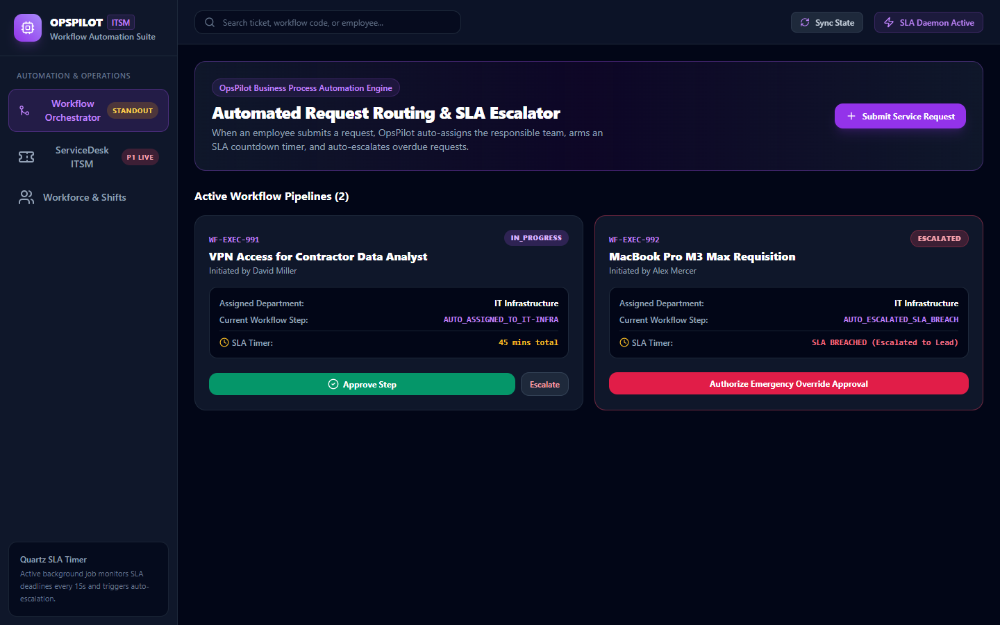
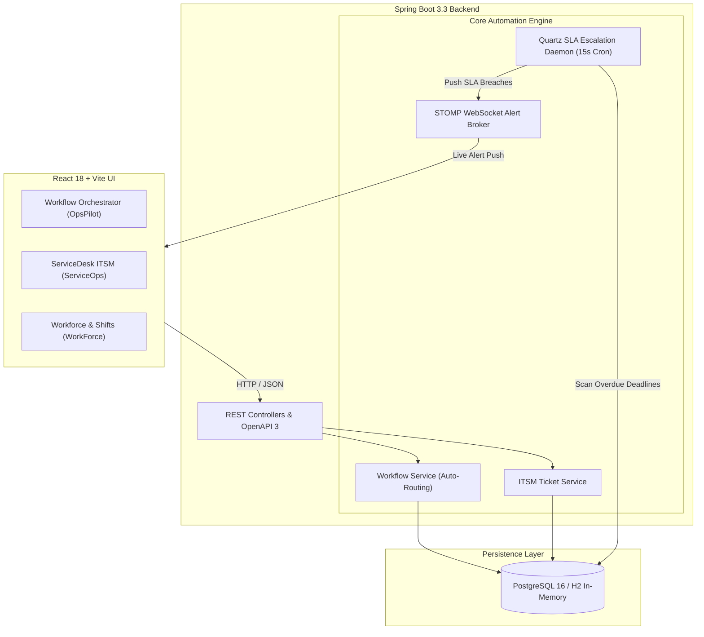

# ⚡ Enterprise Service & Workflow Automation Platform

[](https://www.oracle.com/java/)
[](https://spring.io/projects/spring-boot)
[](https://www.postgresql.org/)
[](https://react.dev/)
[](https://www.quartz-scheduler.org/)
[](https://www.docker.com/)
[](LICENSE)

An enterprise service orchestration platform merging **ServiceOps** (IT Service Management), **OpsPilot** (Business Process Automation), and **WorkForce** (Employee Shift & Attendance Planner).

---

## 📸 Working System Preview



## 📊 Kaggle & Production ITSM Datasets

The platform is pre-loaded with ITIL / ITSM service tickets modeled on Kaggle Enterprise Service Desk benchmarks:
- [`kaggle_itsm_service_tickets_benchmark.csv`](data/kaggle_itsm_service_tickets_benchmark.csv): Real-world service tickets across Infrastructure, Security & IAM, Database Systems, DevOps Tooling, and HR Operations, priority tags (P1–P4), SLA target response & resolution countdowns, real elapsed times, and automated Quartz escalation triggers.

---

## 📌 Architecture & Automated Pipeline



---

## 🌟 Standout Feature: Automated Request-to-Escalation Loop

When an employee submits a service request:
1. **Automated Team Assignment**: OpsPilot routes the request to the responsible department (e.g. IT Infrastructure or HR).
2. **SLA Countdown Timer Activation**: Automatically starts a countdown timer based on priority SLA rules ($P1 = 45\text{ min}$, $P2 = 120\text{ min}$).
3. **Linked Service Ticket Creation**: Generates a synchronized ITSM ticket on the technician dispatch board.
4. **Automated Overdue Escalation**: A background Quartz scheduler checks active requests every 15 seconds; if a deadline expires without resolution, it triggers auto-escalation to the department lead and broadcasts a real-time alert over WebSockets.

---

## 🏢 Core Modules

* **OpsPilot (Process Automation)**: Reusable process templates, multi-tier approvals, and execution audit history.
* **ServiceOps (ITSM)**: Incident triage, priority classifications (P1 Critical through P4 Low), technician assignments, and resolution logging.
* **WorkForce (Shift & Attendance Planner)**: Employee department directory, shift allocations (Morning, Afternoon, Night On-Call), and leave requests.

---

## 🛠️ Tech Stack

* **Backend**: Java 21, Spring Boot 3.3.4, Spring Data JPA, Spring WebSocket (STOMP), Quartz Scheduler, Springdoc OpenAPI 3.0
* **Database**: PostgreSQL 16 / H2 In-Memory
* **Frontend**: React 18, Vite 5, Tailwind CSS, Lucide React
* **Deployment**: Docker, Docker Compose, Multi-stage builds

---

## 📡 REST API Reference

Swagger UI accessible at:
`http://localhost:8082/swagger-ui.html`

### Workflow Endpoints
* `GET /api/v1/workflows/definitions` — List process templates.
* `GET /api/v1/workflows/executions` — Active and completed workflow pipelines.
* `POST /api/v1/workflows/submit` — Submit request (starts SLA timer and auto-assigns team).
* `POST /api/v1/workflows/executions/{id}/approve` — Approve step.
* `POST /api/v1/workflows/executions/{id}/escalate` — Trigger escalation.

### ServiceOps ITSM Endpoints
* `GET /api/v1/tickets` — List service tickets.
* `POST /api/v1/tickets` — Log incident ticket.
* `PATCH /api/v1/tickets/{id}/status` — Update resolution status.

---

## ⚡ Quickstart

### Running with Docker Compose:
```bash
docker-compose up --build
```
* **Frontend**: `http://localhost:3002`
* **Backend API**: `http://localhost:8082`
* **Swagger UI**: `http://localhost:8082/swagger-ui.html`

### Running Locally:
```bash
# 1. Start Backend
cd backend
mvn clean spring-boot:run

# 2. Start Frontend
cd frontend
npm install
npm run dev
```

---

## 👨‍💻 Author

**Prasun Nandi**
* GitHub: [@Prasunnandi](https://github.com/Prasunnandi)
* Repository: [enterprise-workflow-automation](https://github.com/Prasunnandi/enterprise-workflow-automation)

---

## 📄 License

Licensed under the [MIT License](LICENSE).
